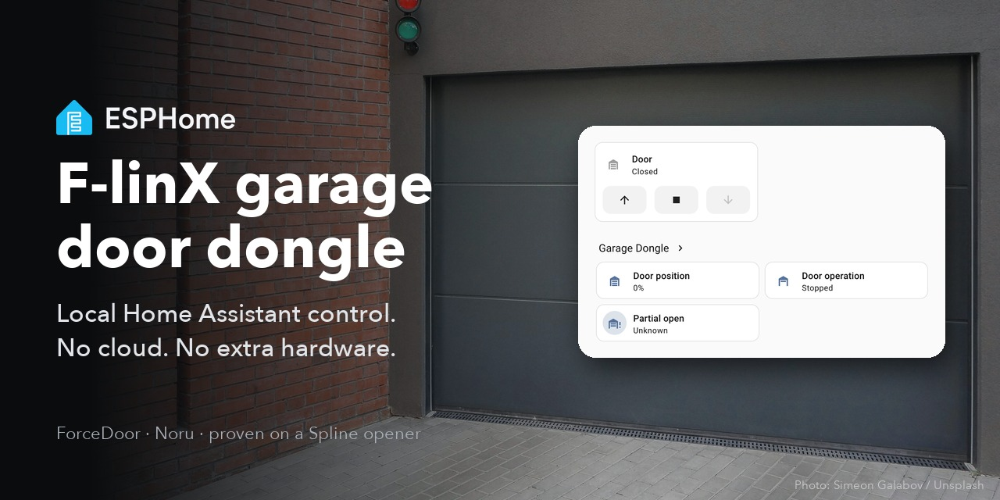

# ESPHome on the F-linX garage door Wi-Fi dongle



Local [Home Assistant](https://www.home-assistant.io/) control for your garage door opener, by
reflashing the opener's own **F-linX "Smart Door - USB 02" Wi-Fi dongle** with
[ESPHome](https://esphome.io/). No extra board: the dongle goes back
into its socket as it came, and talks to Home Assistant instead of the manufacturer's cloud.

Everything you need is in this repo. The [credits](#credits) at the end name the people whose work
made it possible.

**What you get in Home Assistant:**

- a garage door (open, close, stop), whose state comes from the motor itself, not from guessing
- the door position, live, 0-100 %
- the opener's light, and a partial-open button (both still unproven, see below)

**Status (October 2026):** proven on one opener. Open, close, stop, live position, stopping at the end
of travel and stopping mid-travel all work, checked against a door sensor and a camera. **Not yet
proven:** partial open and switching the light.

**Brand names you may know it by:** F-linX (the app, and the label on the dongle), **ForceDoor** (the
openers it is sold for, and the `FORCE DOOR` marking on its circuit board), Noru (what its firmware
calls itself) and ShenZhen BitDoor (the app's maker). Proven on a **Spline** opener
([Spline Automatismos](https://spline.pt/), Portugal).

## Will it work on mine?

Probably, if your opener has this dongle: a small box with a **USB-A plug** that goes into a socket on
the opener, labelled F-linX "Smart Door - USB 02". Check these first:

- **Board revision.** Only one circuit board has been seen: marked `FORCE DOOR 10405023-V1.0`, running
  stock firmware `door_hub` 3.2.0. You see the marking once the case is open. A different revision may
  use different pins.
- **5 V openers.** Some openers in the
  [Home Assistant forum thread](https://community.home-assistant.io/t/garage-door-from-forcedoor/397441)
  put 5 V on that socket instead of 24 V. This dongle would not even power up on 5 V, so those openers
  must ship a different one. This repo may not apply to them.
- **"Status but no commands."** One owner on that thread got the door's status but no reaction to
  commands, using his own home-made board. It was not seen here and is not explained.

If you try it, please report your board marking and what worked, on the
[forum thread](https://community.home-assistant.io/t/garage-door-from-forcedoor/397441) or as an issue
here.

## What you need

**Hardware**

| Item | Why | What was used here |
| --- | --- | --- |
| USB-serial adapter that can output **3.3 V** and has an **RTS** pin | Connects your computer to the dongle's chip, and powers the dongle while you flash. RTS lets the flashing tool reset the chip. | SG-C2102-01C: CP2102 chip, USB-C, a `5V / 3V3` slide switch, pins `VOUT GND TXD RXD RTS CTS` |
| Female Dupont jumper wires, 6 | Adapter to the dongle | A 6-way lead |
| 2.54 mm male pin header, 6 pins | The dongle's `DEBUG` holes are bare | Two 4-pin strips, pressed in |
| A second ground connection | One pin (`9`) must be held at ground while another (`D`) already uses the adapter's only GND pin | The adapter's spare GND pad, with a pin pressed in |
| Small flat-head screwdriver | Opening the case | |
| Multimeter | Checking the adapter really gives 3.3 V, and that `D` is ground | |

**Hold the pins steady.** The pins are only pressed into the holes, and every failed attempt here came
from one losing contact: one dropping out mid-way, the chip going silent, the adapter disconnecting
when touched. Keep a finger on them while reading and flashing.

**Not needed:** the opener itself (the adapter powers the dongle on your desk), a logic analyser, or a
second ESP board.

**Software:** all tools run through [uv](https://docs.astral.sh/uv/getting-started/installation/), so
nothing else needs installing. Install uv first, then:

- `uvx esptool`: [esptool](https://github.com/espressif/esptool), Espressif's tool to back up, flash
  and restore the chip.
- `uvx esphome@2026.9.1`: ESPHome, pinned to the version this config is proven on.

## Flashing

> **Safety.** The opener's socket carries **24 V**. Never have the dongle in the opener while
> anything is wired to it. And never feed **5 V** into the dongle's `3.3` pin: it goes straight to the
> chip.

1. **Unplug the dongle from the opener and open the case.** It pries open easily with a small
   flat-head screwdriver.
2. **Find the `DEBUG` header.** Six holes on the back of the board, labelled `TX RX 3.3 D 9 EN`.
   Fit the pin header.
3. **Set the adapter to 3.3 V and measure it** between VOUT and GND. Also check `D` on the dongle is
   ground: it beeps through to the GND pin of the dongle's USB plug.
4. **Wire it:**

   | Dongle | Adapter |
   | --- | --- |
   | `TX` | RXD |
   | `RX` | TXD |
   | `3.3` | VOUT (set to 3.3 V) |
   | `D` | GND |
   | `EN` | RTS |
   | `9` | a second GND |

   Holding `9` at ground puts the chip in **download mode**, the mode in which it accepts new firmware.
   Leave it connected until flashing is done.
5. **Find the adapter's port name.** Plug the adapter into your computer, then:
   - macOS: `ls /dev/cu.*`, something like `/dev/cu.usbserial-0001`
   - Linux: `ls /dev/ttyUSB*`, usually `/dev/ttyUSB0`
   - Windows: Device Manager → Ports, something like `COM3`

   Use it wherever the commands below say `PORT`.
6. **Check the chip answers:**
   ```sh
   uvx esptool --chip esp32c3 --port PORT chip-id
   ```
   Success prints `Chip type: ESP32-C3` and a MAC address. "No serial data received" means a wire or
   the `9` connection. The dongle's LED stays off in download mode; that is normal.
7. **Back up the original firmware.** It is your only way back to stock. Keep the file private: it
   contains your Wi-Fi password and the dongle's secret key.
   ```sh
   uvx esptool --chip esp32c3 --port PORT read-flash 0 0x400000 stock.bin
   ```
   If it fails part-way (usually a pin losing contact), read it in four 1 MB pieces and join them:
   ```sh
   uvx esptool --chip esp32c3 --port PORT read-flash 0x000000 0x100000 part0.bin
   uvx esptool --chip esp32c3 --port PORT read-flash 0x100000 0x100000 part1.bin
   uvx esptool --chip esp32c3 --port PORT read-flash 0x200000 0x100000 part2.bin
   uvx esptool --chip esp32c3 --port PORT read-flash 0x300000 0x100000 part3.bin
   cat part0.bin part1.bin part2.bin part3.bin > stock.bin
   ```
   (Windows: `copy /b part0.bin+part1.bin+part2.bin+part3.bin stock.bin`.)
8. **Fill in your settings.** Copy `secrets.example.yaml` to `secrets.yaml` and fill it in. The Wi-Fi
   must be **2.4 GHz**; the chip cannot see 5 GHz networks. For `api_key`, make a random key:
   `openssl rand -base64 32`, or any 32-byte base64 key generator.
9. **Flash ESPHome:**
   ```sh
   uvx esphome@2026.9.1 run garage-dongle.yaml --device PORT
   ```
   The first build downloads a lot and takes a few minutes.
10. **Disconnect everything, `9` first, and plug the dongle back into the opener.** It starts ESPHome
    and joins your Wi-Fi.

**Later updates go over Wi-Fi**, no wires needed:
```sh
uvx esphome@2026.9.1 run garage-dongle.yaml --device <the dongle's IP address>
```

**To go back to the original firmware**, wire it up as above and run
`uvx esptool --chip esp32c3 --port PORT write-flash 0 stock.bin`.

**Do not pair the dongle with the F-linX app again** once it runs ESPHome. If you ever restore the
original firmware, its ID is still tied to whatever cloud account it was paired with before.

## In Home Assistant

Home Assistant usually finds the dongle by itself: **Settings → Devices & services**, where "Garage
Dongle" shows up as discovered. If it does not, choose **Add integration → ESPHome** and enter the
dongle's IP address (your router shows it). Either way it asks for the `api_key` from your
`secrets.yaml`.

| Entity | What it is |
| --- | --- |
| `cover.garage_dongle_garage_door` | The door: open, close, stop. |
| `sensor.garage_dongle_door_position` | Position, 0-100 %, live while the door moves. |
| `sensor.garage_dongle_door_operation` | Opening, Stopped or Closing. |
| `light.garage_dongle_opener_light` | The opener's light. Unproven. |
| `button.garage_dongle_partial_open` | Partial open, the ventilation position. Unproven. |

**Send your first command with someone at the door.** It moves a real door; make sure it does what
the button says before you automate anything.

**The door has no position slider on purpose.** With one, Home Assistant opens its door dialog on a
percentage slider, and the opener cannot go to a chosen position anyway. Without it, the dialog opens
on the up, stop and down buttons. The live percentage is still there as its own sensor.

## Troubleshooting

- **Nothing on the `DEBUG` header after flashing.** Normal: ESPHome logs over Wi-Fi, not the header.
  Read them with `uvx esphome@2026.9.1 logs garage-dongle.yaml --device <IP>`, or set
  `logger: hardware_uart: UART0` in the YAML if you need the header.
- **No door status in Home Assistant.** The [`uartex`](https://github.com/eigger/espcomponents) component this config uses silently drops messages it cannot parse, so "nothing received" proves nothing. Uncomment the
  `uart: debug:` block in `garage-dongle.yaml` to log every raw byte.
- **Strange flashing errors.** Only one program may use the serial port at a time. A second one, such
  as an open serial monitor, causes failures that look like bad wiring.
- **Using an older config from elsewhere.** The [`uartex`](https://github.com/eigger/espcomponents) version pinned in
  [jan-k's repository](https://github.com/kratochvil-jan/garage-esp32) (`v251114`) no longer compiles
  on ESPHome 2026.9. This config pins `v260904`.
- **Reading the chip's security settings (efuses).** `espefuse` breaks with a recent dependency. Use
  `uvx -p 3.12 --from esptool --with 'bitstring<4.3' espefuse --chip esp32c3 --port PORT summary`.

## How it works

You do not need this section to use the repo. It is here for anyone extending it or checking a
different board.

### The dongle

| Part | What it is | Notes |
| --- | --- | --- |
| **Wireless-Tag WT32C3-S6** | ESP32-C3 module, 4 MB flash | The Wi-Fi side. This is what gets reflashed. |
| **STC8G1K08** | Small 8051 microcontroller on the back | Sits between the ESP and the opener and passes messages through unchanged. Not touched. |
| **XL1509-3.3** | Power converter, behind a diode | Makes 3.3 V from the opener's 24 V. Needs more than 4.5 V, so a 5 V USB supply does not start it. |
| USB-A plug | **Not USB** | The opener's socket carries **24 V** on the power pin and a **5 V serial line** on the data pins. |
| `DEBUG` header | 6 holes on the back | See below. |

**The ESP talks to the STC** on its second serial port (UART1): **ESP transmit = GPIO6, receive =
GPIO7**, 115200 baud, 8 data bits, no parity, 1 stop bit, at 3.3 V. Found in the original firmware and
proven with ESPHome. **GPIO4 drives the dongle's LED.**

**`DEBUG` header**, as printed:

| Pin | Is |
| --- | --- |
| `TX` | ESP serial transmit (UART0, GPIO21) |
| `RX` | ESP serial receive (UART0, GPIO20) |
| `3.3` | 3.3 V |
| `D` | Ground |
| `9` | GPIO9: held at ground during reset = download mode |
| `EN` | Chip enable, i.e. reset |

> Photos of the board would help here. Pull requests welcome.

### The protocol

Decoded by jan-k on the opener's socket
([kratochvil-jan/garage-esp32](https://github.com/kratochvil-jan/garage-esp32)); the same messages
pass between the ESP and the STC.

- **Message format:** start byte, total length, content, checksum, end byte `0x0D`. The checksum is
  the low byte of the sum of all bytes before it. Start byte `0x23` = to the motor, `0x40` = from the
  motor. The motor **repeats back every command** it gets.
- **Commands:** open `23 07 41 00 00 6b 0d`, stop `23 07 41 01 00 6c 0d`, close
  `23 07 41 02 00 6d 0d`, partial open `23 07 41 03 00 6e 0d`.
- **Status:** 17 bytes starting `40 11 49`. Content byte 1 is `00` opening, `01` stopped, `02`
  closing. Byte 2 is `f0` light on, `f1` light off. Byte 11 is the position, 0-100 %. Sent about three
  times a second while the door moves.

**Found here, not in [jan-k's work](https://github.com/kratochvil-jan/garage-esp32):**

- **Start-up handshake:** the original firmware sends `23 07 45 a5 a5 b9 0d` once at boot, and the STC
  answers with a 30-byte message (`40 1e 45 …`) carrying the dongle's ID. This config sends it too.
- **End of travel:** the motor sends `40 07 41 01 02 8b 0d` (a stop, reason `02`) when the door reaches
  its limit, then a stopped status.
- **Wi-Fi status:** `23 07 41 f3 02 60 0d` every ~1.7 s from the original firmware. It only sets the
  LED pattern and is not reproduced.
- **Light:** the status byte reads reliably; the command is unproven.
  [jan-k's repository](https://github.com/kratochvil-jan/garage-esp32) gives "light on" as both
  `23 07 41 f0 01` (in a comment) and `f0 00` (in the config). This config sends `f0 00`.

The YAML builds on the `uartex` ESPHome component
([eigger/espcomponents](https://github.com/eigger/espcomponents)), which handles the message framing
and checksums.

### The original firmware

ESP-IDF 5.1.2, app `door_hub` 3.2.0, dated 2024-06-20.

- **Cloud only:** it talks plain MQTT to `conn.noru.top:1883` and updates itself over HTTPS. It has no
  local interface at all.
- **Not locked:** flash encryption and secure boot are both off. That is what makes reflashing
  possible.
- **The `DEBUG` header is a console** on the original firmware, prompt `door_hub>`, at 115200 baud.
  Safe, read-only commands: `AT+KEY?` prints the dongle's AES-128 key, plus `AT+BLENAME?`,
  `AT+WIFIMAC?` and `nvs_list nvs`. **Do not type** `reset`, `wifi`, `pair` or `study`: they change
  the device. The AES key might let b12e's Bluetooth integration
  ([b12e/flinx-garage-ha](https://github.com/b12e/flinx-garage-ha)) work without a cloud account;
  that is untested.

## Credits

This builds on other people's work:

- **jan-k (Jan Kratochvíl)** decoded the protocol and built a replacement ESP32 board:
  [kratochvil-jan/garage-esp32](https://github.com/kratochvil-jan/garage-esp32). Every command and
  status message in this config is his decoding. If you would rather not open your dongle, his board
  is the alternative.
- **The [Home Assistant forum thread](https://community.home-assistant.io/t/garage-door-from-forcedoor/397441)**
  where that work happened, with many owners' reports. **dkuku** dumped the original firmware there
  first and found its MQTT server.
- **b12e** wrote a Home Assistant integration for these openers over Bluetooth and the F-linX cloud:
  [b12e/flinx-garage-ha](https://github.com/b12e/flinx-garage-ha).
- **eigger** wrote the `uartex` ESPHome component this config uses:
  [eigger/espcomponents](https://github.com/eigger/espcomponents).

- The banner photo is by **Simeon Galabov** on Unsplash:
  [A grey garage door next to a brick wall](https://unsplash.com/photos/a-grey-garage-door-next-to-a-brick-wall-2PXmPKqEIeQ).
  The ESPHome logo in it is ESPHome's own, from [esphome/esphome.io](https://github.com/esphome/esphome.io).

**What this repo adds:** that the original dongle can be reflashed at all, its circuit board, the
ESP-to-STC connection and pins, the `DEBUG` header, three messages not described elsewhere, and the
original firmware's console.

## License

MIT, for the files in this repo. The protocol decoding is jan-k's; see
[his repository](https://github.com/kratochvil-jan/garage-esp32).
